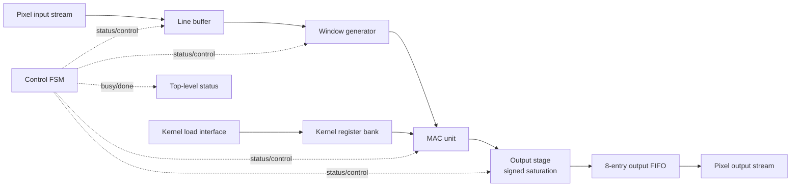

# FPGA Convolution Accelerator

Streaming Verilog implementation of a programmable 3x3 image convolution accelerator. The baseline processes a 32x32 single-channel image with unsigned 8-bit pixels and signed 8-bit kernel coefficients, producing a 30x30 stream of signed 16-bit saturated results.

## Overview

The design implements valid, stride-1 cross-correlation rather than kernel-flipped convolution:

```text
Y(i,j) = sum(X(i+r, j+c) * K(r,c))
```

For the baseline configuration, the input contains 1024 pixels and the output contains 900 pixels. Pixels enter through a ready/valid interface, and results leave through a separate ready/valid interface with an 8-entry output queue. Kernel coefficients are loaded individually before `start` and remain fixed while a frame is running.

## Features

- Parameterized top-level widths and image dimensions, with a baseline of 32x32 and `N=3`.
- Unsigned 8-bit pixel input and signed 8-bit two's-complement kernel coefficients.
- Raster-order streaming input and row-major flattened windows/kernels.
- Circular line buffer for the previous `N-1` rows and horizontal history for sliding windows.
- Nine parallel multipliers and a combinational balanced adder tree for the 3x3 baseline.
- One registered MAC result stage followed by signed saturation to 16 bits.
- Input/output ready/valid handshakes and an 8-entry output FIFO for output backpressure.
- Synchronous reset behavior in all sequential RTL blocks, plus a frame-start soft reset for datapath state.
- Python bit-accurate reference model and 15 checked-in vector cases.
- Yosys ECP5 synthesis artifacts and nextpnr-ecp5 place-and-route artifacts.

## Architecture



The implemented hierarchy is:

```text
conv_top
├── control_fsm
├── line_buffer
├── window_generator
├── mac_unit
│   ├── 9 x multiplier
│   └── adder_tree
└── output_stage
```

## Directory Structure

| Path | Purpose |
| --- | --- |
| `rtl/` | Synthesizable Verilog implementation. |
| `tb/` | Full-system and module-level testbenches. |
| `test_vectors/` | Image, kernel, expected-output, and metadata files used by `conv_tb`. |
| `py_golden/` | Bit-accurate Python model and deterministic vector generator. |
| `syn/` | Yosys synthesis script and wrapper. |
| `reports/` | Checked-in Yosys, ECP5, nextpnr, netlist, BLIF, and timing artifacts. |
| `Docs/` | Architecture, interface, requirements, arithmetic, and golden-model documentation. |
| `*_sim`, `*.vcd` | Existing simulation artifacts; generated simulation outputs are ignored by Git. |

## Design Details

### Top-level parameters

`conv_top` is defined in `rtl/conv_top.v` with these defaults:

| Parameter | Default | Meaning |
| --- | ---: | --- |
| `N` | 3 | Window/kernel dimension used by the baseline datapath. |
| `DATA_WIDTH` | 8 | Unsigned pixel width. |
| `KERNEL_WIDTH` | 8 | Signed coefficient width. |
| `PRODUCT_WIDTH` | 16 | Signed multiplier result width. |
| `ACC_WIDTH` | 20 | Signed accumulator width. |
| `OUT_WIDTH` | 16 | Signed saturated output width. |
| `IMAGE_WIDTH` | 32 | Pixels per input row. |
| `IMAGE_HEIGHT` | 32 | Input rows per frame. |

The `adder_tree` implementation is explicitly written for nine products, so the checked RTL should be treated as a verified 3x3 implementation even though several surrounding modules expose `N` parameters.

### External interface

| Signal | Direction | Width/type | Description |
| --- | --- | --- | --- |
| `clk` | input | 1 | Rising-edge clock. |
| `rst` | input | 1 | Synchronous active-high reset. |
| `start` | input | 1 | Starts a frame from the idle state. |
| `pixel_in` | input | `DATA_WIDTH` | Unsigned raster-order pixel. |
| `pixel_valid` / `pixel_ready` | in / out | 1 | Input transfer occurs when both are high on a rising edge. |
| `kernel_in` | input | signed `KERNEL_WIDTH` | Coefficient value. |
| `kernel_addr` | input | `$clog2(N*N)` | Row-major coefficient index. |
| `kernel_valid` | input | 1 | Stores `kernel_in` at `kernel_addr` when the accelerator is not busy. |
| `pixel_out` | output | signed `OUT_WIDTH` | Saturated result in raster output order. |
| `output_valid` / `output_ready` | out / input | 1 | Output transfer occurs when both are high on a rising edge. |
| `busy` / `done` | output | 1 | FSM status; `done` is asserted in the `S_DONE` state. |

For the baseline, coefficient addresses 0 through 8 map to the 3x3 kernel in row-major order. A new kernel must be loaded before `start`; writes are blocked while `busy` is high.

### Clock, reset, and control

All sequential blocks use `always @(posedge clk)` and test `rst` synchronously. The controller has these states:

| State | Behavior |
| --- | --- |
| `S_IDLE` | Wait for `start`; `busy=0`. |
| `S_LOAD_KERNEL` | One nominal controller state; kernel loading itself is handled by the top-level register bank while idle. |
| `S_FILL_BUFFER` | Accept pixels until a valid column/window is available. |
| `S_COMPUTE` | Stream accepted pixels through the datapath until all `IMAGE_WIDTH*IMAGE_HEIGHT` pixels are accepted. |
| `S_DRAIN` | Allow the five-cycle pipeline to drain. |
| `S_DONE` | Assert `done` for the controller state, then return to idle. |

At each frame start, `conv_top` generates a soft reset for the line buffer, window generator, MAC, output stage, and output FIFO. The top-level pixel counter resets while idle and counts only `pixel_valid && pixel_ready` transfers. `pixel_ready` is additionally limited by the output queue occupancy so in-flight pipeline results cannot overflow the queue.

### Datapath modules

| Module | Responsibility |
| --- | --- |
| `line_buffer` | Stores `(N-1)*IMAGE_WIDTH` pixels in a circular memory. For `N=3`, it emits the two previous-row pixels plus the current pixel for each accepted input. `column_valid` becomes high after enough rows exist. |
| `window_generator` | Keeps the previous `N-1` vertical columns in horizontal history and forms the row-major `N*N` window. The implemented interface includes the current `column` so `window_valid` can enforce both row and column boundaries. |
| `multiplier` | Treats pixels as unsigned values made explicitly non-negative and multiplies them by signed kernel coefficients. The baseline product is signed 16-bit. |
| `adder_tree` | Sign-extends nine products to `ACC_WIDTH` and sums them with a three-stage balanced tree. It is combinational and propagates `products_valid` to `sum_valid`. |
| `mac_unit` | Instantiates nine multipliers and the adder tree, then registers the sum and its valid signal for one pipeline stage. |
| `output_stage` | Clamps the signed accumulator to the signed `OUT_WIDTH` range (`-32768` to `32767` for the baseline) and registers the result. |
| `control_fsm` | Coordinates frame phases and exposes `busy`/`done`. |
| `conv_top` | Owns kernel storage, frame counting, module integration, frame soft reset, and the output FIFO. |

The reference arithmetic models 16-bit signed product assignment, 20-bit signed accumulator assignment after each addition, and final 16-bit signed saturation. The largest documented 3x3 sums are `9*255*127 = 291465` and `9*255*(-128) = -293760`, which saturate to `32767` and `-32768` respectively.

## Verification

### Python reference model

`py_golden/golden_model.py` implements validation, valid stride-1 cross-correlation, two's-complement product/accumulator wrapping, and final signed saturation. Running it directly executes its signedness and saturation self-tests:

```bash
python3 py_golden/golden_model.py
```

`py_golden/generate_tests.py` deterministically generates 15 cases using seed `20260913`, including signed-kernel, saturation, checkerboard, Sobel-X, random, and boundary-value cases:

```bash
python3 py_golden/generate_tests.py
```

The generator currently writes to `py_golden/test_vectors/` because its output root is based on the script directory. The full RTL testbench reads `test_vectors/` at the project root, so generated files must be placed or copied there before using regenerated vectors. The checked-in root-level vectors already contain the 15 cases used by `tb/conv_tb.v`.

### RTL simulation

The repository does not include a simulation Makefile or shell script. The following commands use the source and testbench names present in the repository and write temporary executables outside the checkout:

```bash
# Full 32x32 convolution, checked against test_vectors/*/expected.txt
iverilog -g2012 -o /tmp/conv_sim rtl/*.v tb/conv_tb.v
vvp /tmp/conv_sim

# Module-level benches
for tb in adder_tree control_fsm line_buffer mac_unit multiplier output_stage; do
	iverilog -g2012 -o "/tmp/${tb}_sim" rtl/*.v "tb/${tb}_tb.v"
	vvp "/tmp/${tb}_sim"
done
```

The full testbench loads each case's `image.txt`, `kernel.txt`, and `expected.txt`, streams the image while respecting `pixel_ready`, and compares every accepted output while `output_ready` is high. The module benches separately exercise the adder tree, FSM, line buffer, MAC, multiplier, and saturation stage. Existing waveform benches write `adder_tree_tb.vcd`, `line_buffer_tb.vcd`, and `multiplier_tb.vcd` when run from the project root; GTKWave can open these files.

## Synthesis

The checked-in synthesis flow uses Yosys and is driven by `syn/synth.ys`. From the `syn/` directory:

```bash
cd syn
./run_synth.sh
```

The script reads every RTL source, checks `conv_top` as the top level, emits technology-independent statistics, runs `synth_lattice -family ecp5`, writes the ECP5 JSON and BLIF netlist, emits mapped statistics, writes a selected `conv_top` Verilog netlist, and runs the Yosys `ltp` pass.

The synthesis script targets the Lattice ECP5 family. The checked-in `reports/conv_top.config` identifies the implementation device as `LFE5U-45F-6` with package `CABGA381`. This differs from the earlier design specification, which names Intel MAX 10 `10M50DAF484C7G` and a Terasic DE10-Lite as a target; no Intel-specific synthesis flow is present in the repository.

## Implementation / Place and Route

Checked-in nextpnr-ecp5 artifacts show place and route for `LFE5U-45F-6` / `CABGA381`, including `reports/conv_top_pnr.json`, `reports/pnr_report.json`, and `reports/nextpnr.log`. There is no nextpnr command or implementation script in the repository, so a copy-pasteable place-and-route command cannot be derived from the checked-in files without inventing tool options. The artifacts can be inspected directly.

## Results

### Functional verification

The current repository was run with Icarus Verilog and Python during README preparation:

| Check | Observed result |
| --- | --- |
| Python golden-model self-test | PASS; signedness, saturation, and 30x30 shape checks passed. |
| Full convolution testbench | 15 cases, 0 mismatches. |
| Module-level benches | Adder tree, control FSM, line buffer, MAC, multiplier, and output stage passed. |

### Synthesis and implementation

The following are measured values from the checked-in reports, not design targets:

| Metric | Result | Source |
| --- | ---: | --- |
| ECP5 LUT4 | 446 | `reports/ecp5_stat.txt` |
| ECP5 flip-flops | 307 `TRELLIS_FF` | `reports/ecp5_stat.txt` |
| ECP5 multipliers | 9 `MULT18X18D` | `reports/ecp5_stat.txt` |
| ECP5 distributed RAM blocks | 20 `TRELLIS_DPR16X4` | `reports/ecp5_stat.txt` |
| ECP5 block RAM (`DP16KD`) | 0 | `reports/nextpnr.log` |
| Packed LUT4 total | 620 / 43,848 | `reports/nextpnr.log` |
| Packed FF total | 307 / 43,848 | `reports/nextpnr.log` |
| I/O | 46 / 245 | `reports/nextpnr.log` |
| Maximum frequency | 66.65 MHz | `reports/nextpnr.log` |
| Timing target | 100.00 MHz, reported as FAIL | `reports/conv_top_pnr.json`, `reports/nextpnr.log` |

No power, latency, throughput, or formal-verification measurements are present in the checked-in reports.

## Reproducing the Project

From a clean checkout:

1. Run the Python self-test and inspect the generator output:

   ```bash
   python3 py_golden/golden_model.py
   python3 py_golden/generate_tests.py
   ```

   Because of the generator path noted above, copy regenerated files into the root `test_vectors/` directory before running `conv_tb`, or use the checked-in vectors unchanged.

2. Run the full and module-level simulations using the Icarus commands in [RTL simulation](#rtl-simulation).

3. Run synthesis:

   ```bash
   cd syn
   ./run_synth.sh
   ```

4. Inspect generated synthesis files and reports under `reports/`. Existing place-and-route files are also under `reports/`; no repository script currently reproduces that nextpnr step.

## Requirements

- Python 3 for `py_golden/golden_model.py` and `py_golden/generate_tests.py`.
- Icarus Verilog (`iverilog`) and its runtime (`vvp`) for the supplied simulations.
- Yosys for `syn/run_synth.sh`, including the ECP5 `synth_lattice` support used by `syn/synth.ys`.
- nextpnr-ecp5 and the ECP5 device database only if reproducing the checked-in implementation artifacts; the repository does not provide the invocation.
- GTKWave is optional for viewing the checked-in VCD waveforms.

The checked-in Yosys log reports Yosys 0.66. No simulator or nextpnr version is specified by the project files.

## Project Status

The baseline RTL is implemented and functionally verified by the supplied full-system and module-level simulations. Yosys synthesis and ECP5 place-and-route artifacts are present. The checked-in ECP5 implementation reaches 66.65 MHz against a 100 MHz target, so the recorded timing result does not meet that target.

## Known Limitations / TODO

- `adder_tree.v` is explicitly implemented for nine products; arbitrary `N` values are not supported by the complete datapath despite parameterized module interfaces.
- The line-buffer row counter reuses the `IMAGE_WIDTH` address width and assumes the image height fits that width, as documented in the RTL.
- Regenerated vectors are written under `py_golden/test_vectors/`, while `conv_tb.v` expects root-level `test_vectors/`.
- No nextpnr invocation script, power report, latency/throughput measurement, or formal-verification flow is checked in.
- The design specification names an Intel MAX 10 target, but the available synthesis and implementation artifacts are for Lattice ECP5.

## License

No license is currently specified in the repository.

## Inspected Repository Sources

This README was constructed from the root files, all RTL modules in `rtl/`, all supplied testbenches in `tb/`, the Python files in `py_golden/`, the checked-in vector layout, `syn/run_synth.sh`, `syn/synth.ys`, the reports under `reports/`, and the documentation files under `Docs/`.
